---

# 🚗 AlugaCarros - Sistema de Aluguel de Carros 👨‍💻

> [!NOTE]
> Sistema web para gestão de aluguéis de automóveis: clientes fazem e acompanham pedidos de aluguel pela internet e agentes (empresas e bancos) avaliam os pedidos e executam os contratos.

<table>
  <tr>
    <td width="800px">
      <div align="justify">
        Este projeto é o <b>Laboratório 02</b> da disciplina de <b>Desenvolvimento de Interfaces Web (DIW)</b> da PUC Minas. O <b>AlugaCarros</b> permite que <i>clientes</i> se cadastrem, façam login e criem, modifiquem, consultem e cancelem <b>pedidos de aluguel</b>. Os <i>agentes</i> (empresas e bancos) analisam os pedidos do ponto de vista financeiro, aprovando ou reprovando, e em seguida executam o <b>contrato</b>, definindo se o carro fica registrado como propriedade do cliente, da empresa ou do banco. Os bancos ainda podem associar um <b>contrato de crédito</b> ao aluguel. O sistema foi feito com <b>HTML, CSS e JavaScript</b>, interface em <b>Bootstrap 5</b> e os dados ficam em uma API REST simulada com o <b>JSON Server</b>.
      </div>
    </td>
    <td>
      <div>
        
      </div>
    </td>
  </tr>
</table>

---

## 🚧 Status do Projeto


---

## 📚 Índice
- [Links Úteis](#-links-úteis)
- [Sobre o Projeto](#-sobre-o-projeto)
- [Funcionalidades Principais](#-funcionalidades-principais)
- [Tecnologias Utilizadas](#-tecnologias-utilizadas)
- [Arquitetura](#-arquitetura)
  - [Diagramas](#diagramas)
- [Instalação e Execução](#-instalação-e-execução)
  - [Pré-requisitos](#pré-requisitos)
  - [Instalação de Dependências](#-instalação-de-dependências)
  - [Como Executar a Aplicação](#-como-executar-a-aplicação)
  - [Usuários de teste](#-usuários-de-teste)
- [Estrutura de Pastas](#-estrutura-de-pastas)
- [Demonstração](#-demonstração)
  - [Aplicação Web](#-aplicação-web)
  - [Exemplo de uso da API](#-exemplo-de-uso-da-api)
- [Testes](#-testes)
- [Documentações utilizadas](#-documentações-utilizadas)
- [Autores](#-autores)
- [Agradecimentos](#-agradecimentos)
- [Licença](#-licença)

---

## 🔗 Links Úteis
* 📖 **Histórias de usuário:** [docs/historias-de-usuario.md](docs/historias-de-usuario.md)
* 🧩 **Revisão dos diagramas (v1 → v2):** [docs/revisao-dos-diagramas.md](docs/revisao-dos-diagramas.md)
* 📄 **Enunciado do laboratório:** [repositório da disciplina](https://github.com/joaopauloaramuni/desenvolvimento-de-interfaces-web/tree/main/LABORATORIOS)

> 💻 O projeto roda localmente com o JSON Server (veja [Como Executar a Aplicação](#-como-executar-a-aplicação)), por isso não tem demo online.

---

## 📝 Sobre o Projeto

A proposta do laboratório é desenvolver um sistema de apoio à gestão de aluguéis de automóveis que permita **efetuar, cancelar e modificar pedidos pela internet**.

O sistema só pode ser usado depois de um cadastro prévio. Existem dois tipos de usuário:

- **Clientes** (usuários individuais): introduzem, modificam, consultam e cancelam pedidos de aluguel. Do cliente são guardados RG, CPF, nome, endereço, profissão e até 3 entidades empregadoras com os rendimentos de cada uma.
- **Agentes** (empresas e bancos): modificam e avaliam os pedidos. Depois da análise financeira, se o parecer for positivo, o pedido pode virar contrato.

Dependendo do contrato, o automóvel fica registrado como propriedade do cliente, da empresa ou do banco. O aluguel também pode estar associado a um **contrato de crédito** concedido por um dos bancos agentes. Sobre os automóveis são guardados matrícula, ano, marca, modelo e placa.

O sistema foi dividido em dois subsistemas, como pedido no enunciado:
1. **Gestão de pedidos e contratos** - os serviços em `public/js/servicos`, que fazem as chamadas à API.
2. **Construção dinâmica das páginas web** - as páginas HTML e os scripts em `public/js/paginas`, que montam as tabelas, formulários e modais com os dados vindos da API.

O desenvolvimento seguiu as etapas do enunciado (modelagem → diagrama de componentes → CRUD de cliente → protótipo → revisão dos diagramas), e cada etapa foi sendo enviada para o GitHub em commits separados.

---

## ✨ Funcionalidades Principais

- 🔐 **Cadastro e login:** cliente cria a própria conta; clientes e agentes entram com e-mail e senha.
- 👤 **CRUD de clientes:** cadastro, listagem, edição e exclusão de clientes, com até 3 rendimentos e validação de CPF repetido.
- 🙋 **Meus dados:** o cliente altera ou exclui o próprio cadastro (o CPF não pode ser alterado).
- 📝 **Pedidos de aluguel:** o cliente escolhe o automóvel e as datas, acompanha o status e o parecer, e pode modificar ou cancelar o pedido.
- 📊 **Avaliação financeira:** o agente vê os rendimentos do cliente, pode alterar o pedido e aprovar ou reprovar com um parecer.
- 📃 **Execução do contrato:** para pedidos aprovados, o agente define quem fica como proprietário do carro (cliente, empresa ou banco).
- 🏦 **Contrato de crédito:** quando o agente é um banco, ele pode associar um crédito ao contrato.
- 🔎 **Filtro por status** na tela de avaliação dos agentes.

---

## 🛠 Tecnologias Utilizadas

### 💻 Front-end

* **Estrutura e lógica:** HTML5, CSS3 e JavaScript (ES6+)
* **Interface:** [Bootstrap 5.3.3](https://getbootstrap.com/) (via CDN)
* **Requisições HTTP:** Fetch API
* **Sessão do usuário:** `localStorage` do navegador

### 🖥️ Back-end (API simulada)

* **API REST e persistência:** [JSON Server](https://github.com/typicode/json-server) a partir do arquivo `db.json`
* **Runtime:** Node.js (necessário só para rodar o JSON Server)

### 📐 Modelagem

* **Diagramas UML:** [PlantUML](https://plantuml.com/) (arquivos `.puml` e imagens `.png` em `docs/diagramas`)

---

## 🏗 Arquitetura

O sistema segue uma arquitetura simples em camadas, rodando quase toda no navegador:

- **Visão:** páginas HTML com Bootstrap (`public/*.html`).
- **Controle:** um script para cada página (`public/js/paginas`), que lê os formulários, trata os eventos e monta o HTML dinamicamente.
- **Serviços:** um arquivo para cada recurso da API (`public/js/servicos`), com as funções que usam `fetch` (`GET`, `POST`, `PATCH`, `DELETE`).
- **Apoio:** `config.js` (endereço da API), `sessao.js` (usuário logado e proteção das páginas) e `utils.js` (formatação de datas, valores e cores de status).
- **Persistência:** o JSON Server transforma cada chave do `db.json` em uma rota REST (`/clientes`, `/agentes`, `/automoveis`, `/pedidos`, `/contratos`).

**Fluxo de um pedido:**

```
Cliente cria o pedido ──► Em análise ──► Agente aprova ──► Aprovado ──► Agente executa contrato ──► Contratado
                              │                │
                              │                └──► Agente reprova ──► Reprovado
                              └──► Cliente cancela ──► Cancelado (também pode cancelar quando está Aprovado)
```

Decisões e limitações:
- Como o JSON Server é só uma API de teste, o login compara a senha no próprio navegador e as senhas ficam em texto no `db.json`. Em um sistema real isso seria feito no back-end com senha criptografada.
- Empresa e Banco ficam na mesma coleção `/agentes`, diferenciados pelo campo `tipo`.

### Diagramas

Os diagramas foram feitos em duas versões: a **v1** é a modelagem inicial e a **v2** é a revisão feita depois da implementação, alinhada com o código. As mudanças estão explicadas em [docs/revisao-dos-diagramas.md](docs/revisao-dos-diagramas.md).

| Diagrama de Casos de Uso (v2) | Diagrama de Classes (v2) |
| :---: | :---: |
| 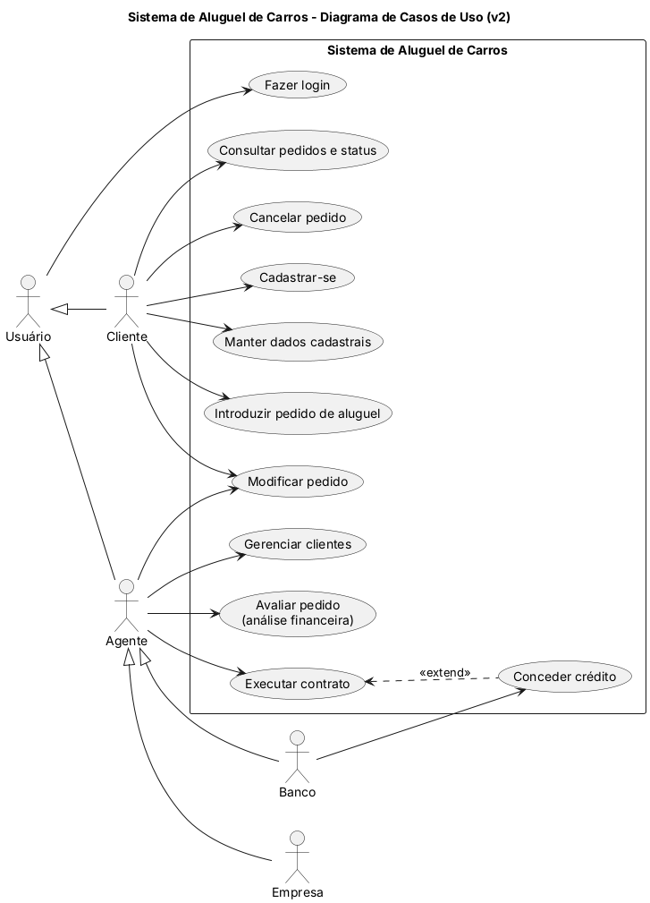 | 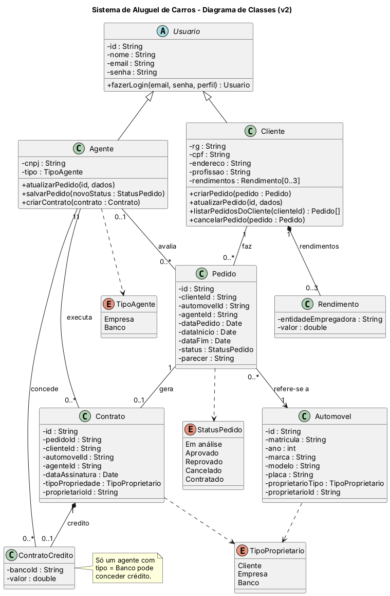 |
| **Diagrama de Pacotes (v2)** | **Diagrama de Componentes (v2)** |
| 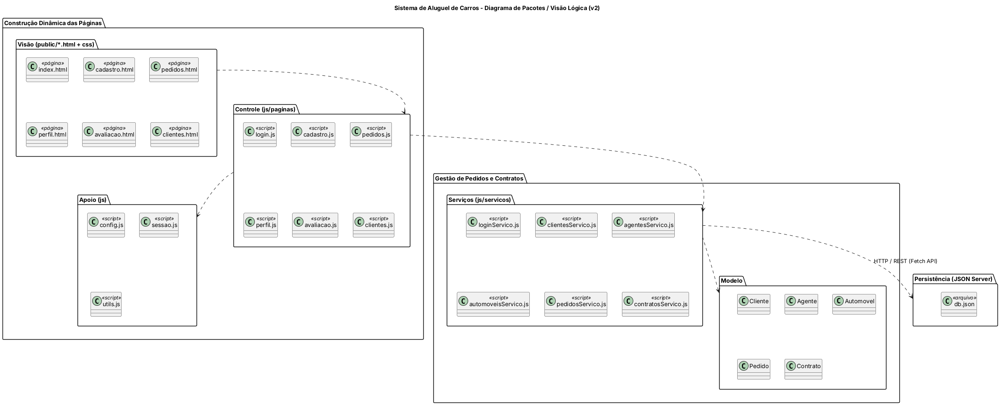 | 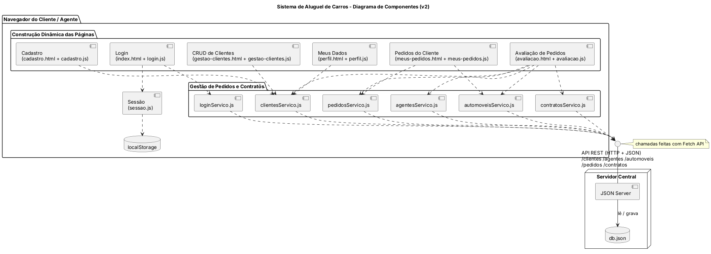 |

Versões anteriores (v1): [casos de uso](docs/diagramas/v1/casos-de-uso.png) · [classes](docs/diagramas/v1/classes.png) · [pacotes](docs/diagramas/v1/pacotes.png) · [componentes](docs/diagramas/v1/componentes.png)

Para gerar as imagens de novo depois de alterar um `.puml`:

```bash
java -jar plantuml.jar -tpng -charset UTF-8 docs/diagramas/v2/*.puml
```

---

## 🔧 Instalação e Execução

### Pré-requisitos

* **Node.js:** versão **22.12 ou superior** (exigida pela versão atual do JSON Server)
* **Gerenciador de pacotes:** npm (já vem com o Node.js)
* Um navegador atualizado

Para conferir a versão do Node:

```bash
node -v
```

### 📦 Instalação de Dependências

1. **Clone o repositório:**

```bash
git clone https://github.com/davicampolina/DIW-LAB2.git
cd DIW-LAB2
```

2. **Instale o JSON Server:**

```bash
npm install
```

### ⚡ Como Executar a Aplicação

Na pasta do projeto (onde está o `db.json`), rode:

```bash
npm start
```

ou, sem instalar nada antes:

```bash
npx json-server db.json
```

🚀 *Abra no navegador: **http://localhost:3000***

O JSON Server serve automaticamente a pasta `public/`, então a página e a API ficam no mesmo endereço. Para parar o servidor use `Ctrl + C`.

> [!NOTE]
> Os scripts usam a API em `http://localhost:3000` (constante `API_URL` em `public/js/config.js`). Se rodar o JSON Server em outra porta, altere essa constante também.

### 👥 Usuários de teste

| Perfil | E-mail | Senha |
| :--- | :--- | :--- |
| Cliente | `mariana@email.com` | `123` |
| Cliente | `carlos@email.com` | `123` |
| Agente (Empresa) | `empresa@rota.com` | `123` |
| Agente (Banco) | `banco@horizonte.com` | `123` |

---

## 📂 Estrutura de Pastas

```
.
├── README.md                     # 📘 Documentação do projeto
├── LICENSE                       # ⚖️ Licença MIT
├── package.json                  # 📦 Dependência e script do JSON Server
├── db.json                       # 💾 "Banco de dados" usado pelo JSON Server
│
├── /docs
│   ├── historias-de-usuario.md   # 📝 Histórias de usuário
│   ├── revisao-dos-diagramas.md  # 🔄 O que mudou entre a v1 e a v2 dos diagramas
│   ├── /diagramas
│   │   ├── /v1                   # 📐 Modelagem inicial (.puml + .png)
│   │   └── /v2                   # 📐 Modelagem revisada após o código (.puml + .png)
│   └── /img                      # 🖼️ Logo e prints das telas
│
└── /public                       # 🌐 Front-end servido pelo JSON Server
    ├── index.html                # 🔐 Login
    ├── cadastro.html             # 🙋 Cadastro de cliente
    ├── pedidos.html              # 📝 Pedidos do cliente
    ├── perfil.html               # 👤 Meus dados (cliente)
    ├── avaliacao.html            # 📊 Avaliação de pedidos e contratos (agente)
    ├── clientes.html             # 👥 CRUD de clientes (agente)
    ├── /css
    │   └── style.css             # 🎨 Ajustes de estilo além do Bootstrap
    └── /js
        ├── config.js             # 🔧 Endereço da API
        ├── sessao.js             # 🔑 Usuário logado (localStorage)
        ├── utils.js              # 🛠️ Funções de formatação
        ├── /servicos             # 🔌 Chamadas à API com fetch
        │   ├── loginServico.js
        │   ├── clientesServico.js
        │   ├── agentesServico.js
        │   ├── automoveisServico.js
        │   ├── pedidosServico.js
        │   └── contratosServico.js
        └── /paginas              # 📄 Lógica de cada página
            ├── login.js
            ├── cadastro.js
            ├── pedidos.js
            ├── perfil.js
            ├── avaliacao.js
            └── clientes.js
```

---

## 🎥 Demonstração

### 🌐 Aplicação Web

| Tela | Captura de Tela |
| :---: | :---: |
| **Login** | **Cadastro de Cliente** |
| 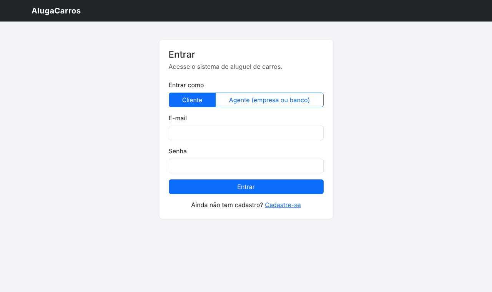 | 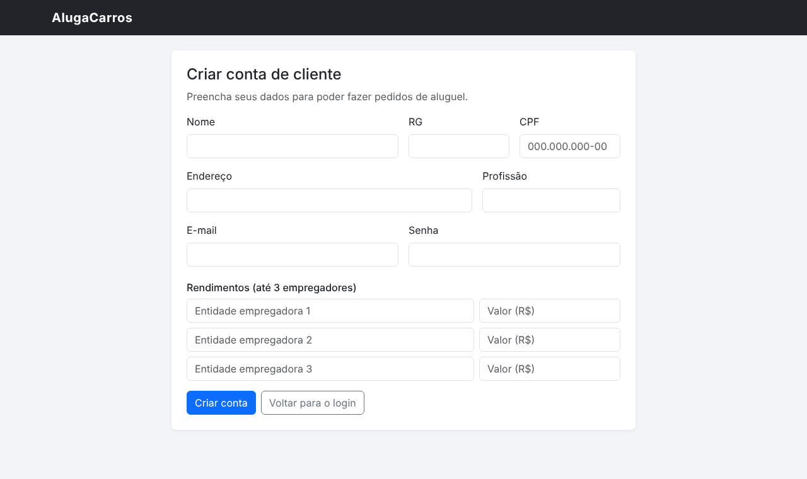 |
| **Pedidos do Cliente** | **CRUD de Clientes (agente)** |
| 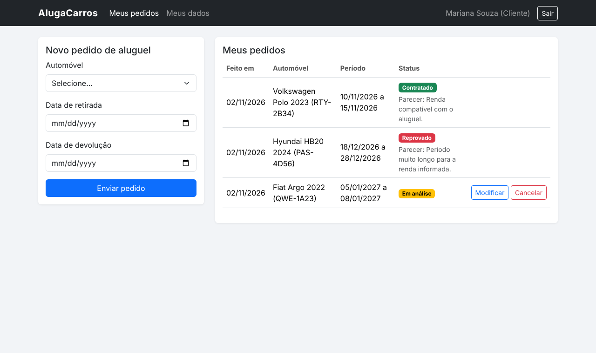 | 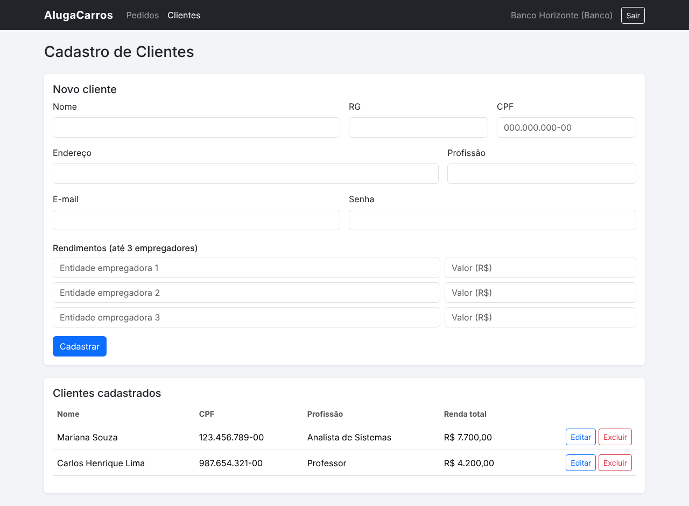 |
| **Análise Financeira do Pedido** | **Execução do Contrato com Crédito** |
| 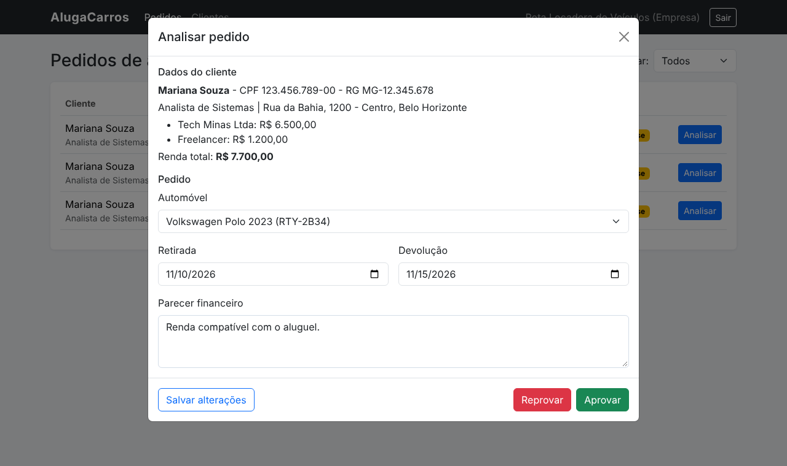 | 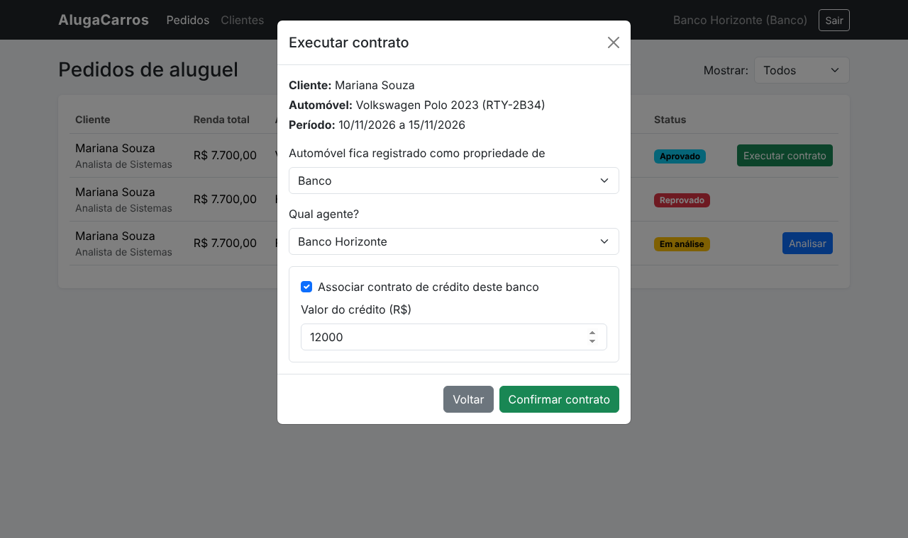 |
| **Avaliação de Pedidos (agente)** | |
| 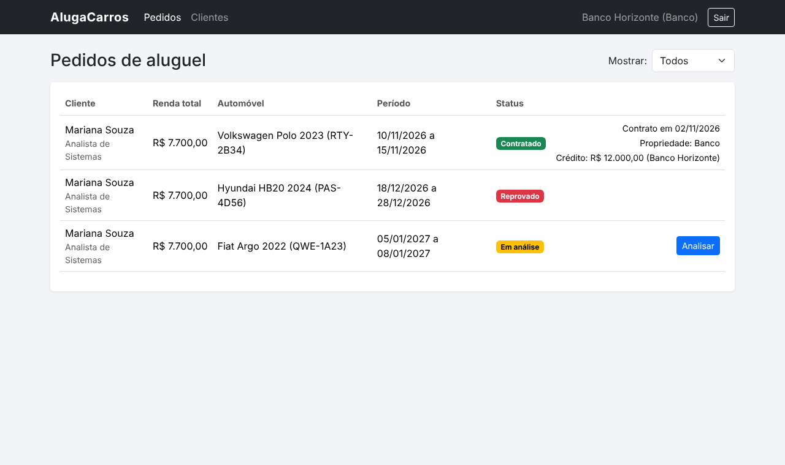 | |

### 💻 Exemplo de uso da API

Rotas criadas pelo JSON Server a partir do `db.json`:

| Método | Rota | Usado em |
| :--- | :--- | :--- |
| `GET` | `/clientes`, `/clientes/:id`, `/clientes?cpf=...` | `clientesServico.js` |
| `POST` / `PATCH` / `DELETE` | `/clientes`, `/clientes/:id` | `clientesServico.js` |
| `GET` | `/clientes?email=...`, `/agentes?email=...` | `loginServico.js` |
| `GET` | `/agentes` | `agentesServico.js` |
| `GET` / `PATCH` | `/automoveis`, `/automoveis/:id` | `automoveisServico.js` |
| `GET` / `POST` / `PATCH` | `/pedidos`, `/pedidos?clienteId=...`, `/pedidos/:id` | `pedidosServico.js` |
| `GET` / `POST` | `/contratos` | `contratosServico.js` |

Exemplo buscando os pedidos de um cliente:

```bash
curl http://localhost:3000/pedidos?clienteId=1
```

**Saída esperada:**
```json
[
  {
    "id": "1",
    "clienteId": "1",
    "automovelId": "2",
    "dataInicio": "2026-11-10",
    "dataFim": "2026-11-15",
    "dataPedido": "2026-11-02",
    "status": "Em análise",
    "parecer": "",
    "agenteId": ""
  }
]
```

---

## 🧪 Testes

O projeto não tem testes automatizados. Os testes foram feitos manualmente no navegador seguindo os critérios de aceitação das [histórias de usuário](docs/historias-de-usuario.md):

- [x] Cadastro de cliente e bloqueio de CPF repetido
- [x] Login com senha errada mostra mensagem de erro
- [x] Páginas protegidas voltam para o login quando não há usuário logado
- [x] Cliente cria, modifica e cancela pedidos
- [x] Data de devolução antes da retirada não é aceita
- [x] Agente altera, aprova e reprova pedidos com parecer
- [x] Agente executa contrato e o proprietário do automóvel é atualizado no `db.json`
- [x] Só o banco vê a opção de contrato de crédito
- [x] CRUD completo de clientes na página do agente

---

## 🔗 Documentações utilizadas

* 📖 **Interface:** [Documentação do **Bootstrap 5**](https://getbootstrap.com/docs/5.3/getting-started/introduction/)
* 📖 **API simulada:** [Repositório e documentação do **JSON Server**](https://github.com/typicode/json-server)
* 📖 **Requisições:** [**Fetch API** - MDN](https://developer.mozilla.org/pt-BR/docs/Web/API/Fetch_API)
* 📖 **Diagramas:** [Documentação do **PlantUML**](https://plantuml.com/pt/)
* 📖 **Projetos de exemplo:** [Repositório da disciplina de DIW](https://github.com/joaopauloaramuni/desenvolvimento-de-interfaces-web)

---

## 👥 Autores

| 👤 Nome | 🖼️ Foto | :octocat: GitHub | 📤 E-mail |
|---------|----------|-----------------|-----------|
| Davi Campolina Rocha | <div align="center"></div> | <div align="center"><a href="https://github.com/davicampolina"></a></div> | <div align="center"><a href="mailto:davi.campol.rocha@gmail.com"></a></div> |

---

## 🙏 Agradecimentos

* [**Engenharia de Software PUC Minas**](https://www.instagram.com/engsoftwarepucminas/) - Pelo apoio institucional e estrutura acadêmica.
* [**Prof. Dr. João Paulo Aramuni**](https://github.com/joaopauloaramuni) - Pelos ensinamentos em **Desenvolvimento de Interfaces Web** e pelos projetos de exemplo com JSON Server usados como referência.

---

## 📄 Licença

Este projeto é distribuído sob a **[Licença MIT](LICENSE)**.

---
